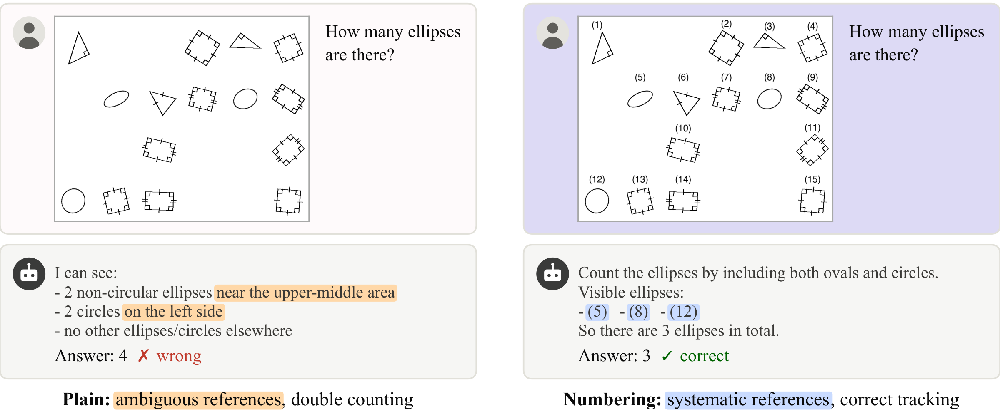
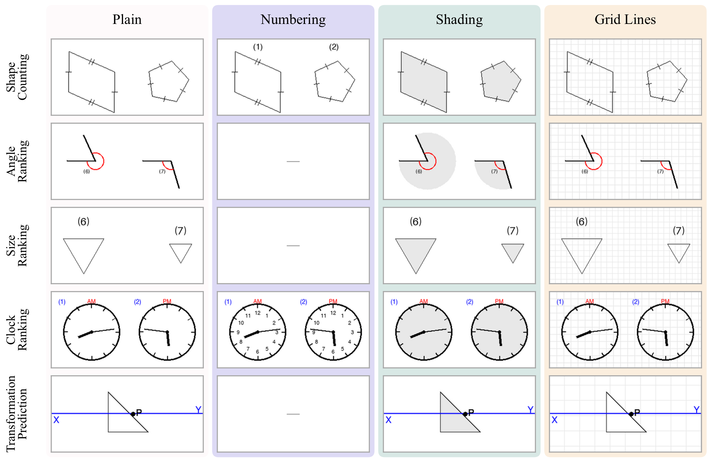

# Diagnosing the Reference Gap: What Visual Scaffolds Can and Cannot Fix in Multimodal Reasoning

[**Paper**](https://arxiv.org/abs/2610.39419) | [**Website**](https://regap-bench.github.io/) | [**Dataset**](https://huggingface.co/datasets/regap-bench/ReGap-Bench)

Code and data for **ReGap-Bench**, a paired reference-intervention benchmark for multimodal large language models (MLLMs).



## Overview

MLLMs can recognize visual content yet struggle to reason over it across multiple steps. In counting, a model may see every object but lose track of which ones it has already counted. We call this the **reference gap**: the failure to bind language-based reasoning to the relevant visual entities, regions, or locations.

ReGap-Bench tests whether external references can narrow this gap. Each scene is rendered with and without an added reference, while the scene content, question, and answer stay fixed, so any change in accuracy comes from the reference alone. We study three references, motivated by Ullman's theory of visual routines:

- **Numbering** supports indexing and marking.
- **Shading** supports bounded activation.
- **Grid lines** support focus shifts and boundary tracing.

Task-matched references improve every evaluated model on every task, by up to 25%, while mismatched references help little or even hurt.

## Benchmark



ReGap-Bench has five tasks with 200 scenes each, rendered into 3,400 images.

| Task | Question | Answer | Reference conditions | Images |
|---|---|---|---|---|
| `shape_counting` | Count shapes of a given class | integer | plain, numbering, shading, grid | 800 |
| `angle_ranking` | Rank angles by size | list of labels | plain, shading, grid | 600 |
| `size_ranking` | Rank shapes by size | list of labels | plain, shading, grid | 600 |
| `clock_ranking` | Rank clocks by time | list of labels | plain, numbering, shading, grid | 800 |
| `transformation_prediction` | Pick the result of a transformation chain | option letter (A–D) | plain, shading, grid | 600 |

## Setup

```bash
conda create -n regap python=3.10 -y
conda activate regap
pip install -r requirements.txt
```

`vllm` and `transformers` are only needed for Qwen3.5 and require a GPU; skip them if you only use API models. Set the API keys for the providers you use, in the environment or in a `.env` file at the repository root:

```bash
OPENAI_API_KEY=...
```

Run the scripts from the repository root.

## Run models

```bash
python inference.py --task shape_counting --setting images_number --model gpt-5.4-mini
```

| Provider | `--provider` | Example `--model` |
|---|---|---|
| OpenAI | `openai` | `gpt-5.4-mini` |
| Google Gemini | `gemini` | `gemini-3.1-flash-lite` |
| Qwen3.5 (vLLM) | `qwen35` | `Qwen/Qwen3.5-27B` |


Settings are `images_plain`, `images_number`, `images_shading`, and `images_grid`. Each task only has the settings listed in the benchmark table.

Outputs go to `outputs/{task}/{setting}/{model}/{id}.json`. Inference is resumable: re-running skips samples that already have an output unless you pass `--overwrite`.

## Evaluate

```bash
python evaluation.py --task shape_counting --setting images_number --model gpt-5.4-mini
# or point it at an output folder directly
python evaluation.py --output-path outputs/shape_counting/images_number/gpt-5.4-mini
```

## Citation

```bibtex
@misc{chen2026diagnosingreferencegapvisual,
      title={Diagnosing the Reference Gap: What Visual Scaffolds Can and Cannot Fix in Multimodal Reasoning}, 
      author={Guizhen Chen and Weiwen Xu and Wotao Yin and Anh Tuan Luu and Hou Pong Chan},
      year={2026},
      eprint={2610.39419},
      archivePrefix={arXiv},
      primaryClass={cs.CV},
      url={https://arxiv.org/abs/2610.39419}, 
}
```
